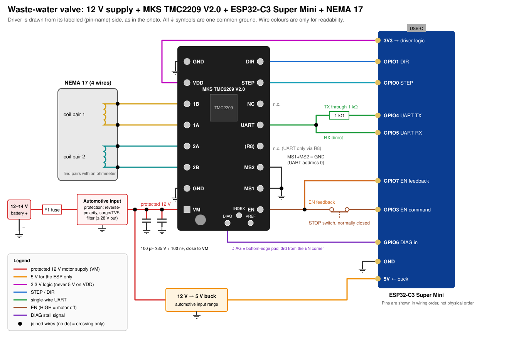

# Waste-water valve wiring guide

Hardware: **MKS TMC2209 V2.0** driver (PCB marking `M-D-X-S-01020 001`),
ESP32-C3 Super Mini, four-wire NEMA 17 and the vehicle 12–14 V battery.
This is a **functional wiring guide, not a verified vehicle installation**.
Read the [commissioning steps and limitations](README.md) before powering it.



The driver is drawn from its **labelled side** (pin names printed next to the
pins, potentiometer at the bottom near VM), the same way it looks in the
photo of the board. The ESP32-C3 pins are listed in wiring order; find them by
the labels printed on your Super Mini.

## 1. Know the driver board

Seen from the labelled side, with DIR at the top right:

| Left column (power + motor) | Right column (control) |
|---|---|
| `GND` | `DIR` |
| `VDD` – logic supply (printed 3.3–5 V, **use 3.3 V**) | `STEP` |
| `1B` | `NC` – not connected (CLK only if R5 is fitted) |
| `1A` | `UART` – PDN_UART, the single-wire UART |
| `2A` | unlabelled – UART **only if R8 is fitted**, otherwise open |
| `2B` | `MS2` |
| `GND` | `MS1` |
| `VM` – square pad, motor supply (unlabelled on some prints) | `EN` – active-low enable |

Three extra pads sit on the **bottom edge between the potentiometer and EN**.
Counting from the EN corner: `VREF`, `INDEX` (slightly raised, further from
the edge) and **`DIAG`**. DIAG is the third pad from EN, i.e. the one closest
to the potentiometer. It is the only connection to the stall signal; it is not
on the 2 × 8 headers. Confirm with a continuity test to TMC2209 pin 11 if the
print on your board differs.

Facts from the [MKS V2.0 schematic](https://github.com/makerbase-mks/MKS-StepStick-Driver/tree/master/MKS%20TMC2209/MKS%20TMC2209%20V2.0_001)
that this design relies on:

| Item | On the board | Consequence |
|---|---|---|
| EN | 20 kΩ pull-up (R2) to VDD | Driver is **off** whenever EN is left open. No external pull-up is required. |
| PDN_UART | 20 kΩ pull-down (R1) | Normal for UART mode; wire TX through 1 kΩ and RX directly. |
| MS1 / MS2 | No strap resistors | Tie both to GND → UART address 0 (`tmc_address: "0"`). |
| SPREAD | Pull-up R9 not fitted | SPREAD is low; the firmware checks this via `IOIN` and refuses to run otherwise. |
| Sense resistors | R6/R7 marked `R110` = 0.11 Ω | Matches `sense_resistance: "0.11"`. |
| VREF potentiometer | Analog current reference | **Ignored**: the firmware sets current over UART (`I_scale_analog = 0`). Don't connect the VREF pad. |
| VM capacitors | Only 100 nF + 1 µF/50 V | Add an external bulk capacitor at VM (below). |
| VDD level | Sets DIAG/UART output level | MKS requires 3.3 V for sensorless homing; 5 V would also damage ESP GPIOs. |

Inspect the bottom side near the UART pin (the R8 position) and the NC pin
(R5). If you don't know whether R8 is fitted, simply leave the pin below
`UART` unconnected — it is then either open or the same UART node.

## 2. Connection list

Wire with **all power disconnected**. Tick each line off as you go.

### Power

| # | From | To | Notes |
|---|---|---|---|
| P1 | Battery + | F1 fuse | Fuse close to the battery, rated for the cable. |
| P2 | F1 | Automotive input protection | Reverse polarity, surge/load-dump (TVS) and filtering. Output must stay ≤ 28 V. |
| P3 | Protected 12 V | Driver `VM` | Add 100 µF low-ESR electrolytic (≥ 35 V) + 100 nF ceramic right at VM–GND. Mind polarity. |
| P4 | Protected 12 V | 12 V→5 V buck input | Buck must tolerate the vehicle input range. |
| P5 | Buck 5 V out | ESP `5V` | ESP only — never the driver. |
| P6 | ESP `3V3` | Driver `VDD` | Driver logic supply, 3.3 V only. |
| P7 | Battery − / common ground | Driver `GND` (next to VM), buck GND, ESP `GND` | One common ground; run the motor return via the GND next to VM. The two driver GND pins are connected on the board. |

### Motor

| # | From | To | Notes |
|---|---|---|---|
| M1 | Coil pair 1 | Driver `1A` + `1B` | Find pairs with an ohmmeter: a few Ω between the two wires of a pair, open between pairs. |
| M2 | Coil pair 2 | Driver `2A` + `2B` | Wire colours are not reliable. Swapping the two wires of **one** pair reverses direction (or use `direction_inverted`). |

Never connect or disconnect the motor while the driver is powered.

### Control signals (3.3 V)

| # | ESP32-C3 | Driver | Notes |
|---|---|---|---|
| S1 | `GPIO0` | `STEP` | |
| S2 | `GPIO1` | `DIR` | |
| S3 | `GPIO4` (UART TX) | `UART` | **Through a 1 kΩ resistor.** |
| S4 | `GPIO5` (UART RX) | `UART` | Direct, joined with S3 at the UART pin. |
| S5 | `GPIO3` (EN command) | STOP switch → `EN` | Default wiring uses a normally-closed STOP switch in the EN wire (section 3). |
| S6 | `GPIO7` (EN feedback) | `EN` | Connect on the **driver side** of STOP. Without STOP, connect directly to the same EN node as GPIO3. |
| S7 | `GPIO6` (DIAG) | `DIAG` bottom pad | Stall signal for sensorless homing. |
| S8 | GND | `MS1` and `MS2` | Sets UART address 0. |

Leave unconnected: `NC`, the pin under `UART` (R8), `INDEX`, `VREF`. On the
ESP, GPIO8/GPIO9 (boot straps) and GPIO18/GPIO19 (USB) are not used.

## 3. STOP switch and EN

```text
GPIO3 ──o STOP (NC) o──┬── EN (driver, 20 kΩ pull-up to VDD on board)
                       └── GPIO7 (feedback)
```

- EN **HIGH = motor off**, LOW = motor energised. The firmware drives GPIO3
  LOW only while moving.
- Opening STOP disconnects GPIO3, so the on-board pull-up forces the driver off
  even if the ESP misbehaves. GPIO7 sees the real EN level and the firmware
  faults and forgets the position if it does not match.
- Use a switch that is accessible and normally closed. It switches only the
  low-current EN signal; it is **not** a certified emergency stop and does not
  cut motor power. Stopping mid-travel leaves the valve where it is.
- Never connect GPIO3 to GPIO7 on the ESP side of the switch.
- Check with a meter: with STOP open or the ESP in reset, EN must read about
  3.3 V. Without VDD the pull-up cannot work, so the motor must also be safe
  when the ESP/3.3 V is lost (see power sequencing).

### Optional variant: no STOP switch (accepted risk)

If you intentionally do not use the physical STOP switch:

```text
GPIO3 ───────────────┬── EN (driver)
GPIO7 ───────────────┘
```

- Keep `GPIO7` connected to EN feedback. It is still used by the firmware to
  verify the commanded EN level.
- You lose independent hardware disable of the motor-enable signal.
- Before commissioning, confirm with a meter:
  - idle (no motion): EN is HIGH,
  - during commanded movement: EN goes LOW,
  - fault or stop command: EN returns HIGH.
- All other protections in this guide remain required (VM/VDD sequencing,
  surge protection, coupling limits, and timeout/travel bounds).

## 4. Vehicle power and sequencing

- A "12 V" vehicle system sees cranking dips, reverse connection and spikes
  well above 14 V. The TMC2209 is rated 4.75–29 V; use an automotive-rated
  protection stage so VM never exceeds about 28 V. A TVS standoff voltage is
  not its clamp voltage, and the bulk capacitor is not surge protection.
- **Power VM before VDD and remove VDD before VM.** With the ESP fed from the
  same protected 12 V through the buck this normally happens naturally, but
  verify it on your build. Don't leave VDD or the STEP/DIR/UART/EN lines
  powered while VM is missing for long.
- Don't connect USB while the 5 V buck powers the ESP unless your Super Mini
  has verified power-path isolation. For USB flashing on the bench, disconnect
  the buck 5 V, or power everything from the bench supply and use a data-only
  USB connection.
- To rewire: stop the motor, open STOP if fitted, remove the 12 V supply, wait
  for the capacitors to discharge and measure 0 V.
- Keep motor wires away from the UART wires and ESP antenna, strain-relieve
  all cables and protect the electronics from spray.

## 5. Checks before first power

1. Motor coil pairs measured; each pair on `1A/1B` or `2A/2B`.
2. Polarity of VM, bulk capacitor and buck verified; fuse fitted.
3. `VDD` connected to **3V3**, not 5V.
4. 1 kΩ only in the TX (GPIO4) line; RX (GPIO5) direct.
5. MS1/MS2 to GND; NC, R8-pin, INDEX and VREF unconnected.
6. DIAG wire on the bottom pad third from EN, to GPIO6.
7. If STOP is fitted: keep it open for first power-up and close only when
   ready. If STOP is not fitted: verify EN idles HIGH. In both cases, first
   power-up uses `commissioned: "false"` in the firmware.
